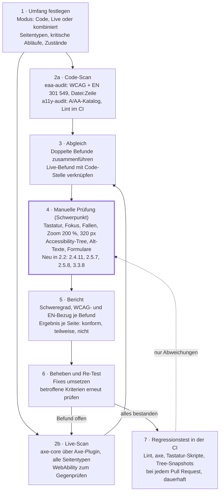

# Barrierefreiheits-Supertest – Konzept

Stand: 18.11.2026 · Vollständige Fassung des Claude-Dokuments [„Barrierefreiheits-Supertest – Konzept“](https://claude.ai/artifact/G496eLvKR7gnZ8M4pv6KiX). Die Kurzfassung für die Arbeit im Repository steht in [konzept.md](konzept.md).

## Ziel und Geltungsbereich

Der Supertest prüft eine Website gegen **WCAG 2.2 Stufe AA**. Damit sind WCAG 2.1 AA und die Web-Anforderungen der EN 301 549 abgedeckt, auf die das Barrierefreiheitsstärkungsgesetz (BFSG) verweist.

Er läuft in zwei Modi, die einzeln oder kombiniert genutzt werden:

| Modus | Eingabe | Stärke | Blinder Fleck |
| --- | --- | --- | --- |
| **Code** | Repository, Komponenten, HTML-Templates | Findet Ursachen mit Datei und Zeile, auch in Zuständen, die selten sichtbar sind | Sieht kein gerendertes Ergebnis (Kontrast über CSS-Variablen, dynamische Inhalte) |
| **Live** | URL einer öffentlichen oder Staging-Seite | Prüft, was Nutzer:innen tatsächlich bekommen, inkl. Tastatur und Fokus | Kennt die Ursache im Code nicht |
| **Kombiniert** | beides | Live-Befund wird mit der Code-Stelle verknüpft | höherer Aufwand |

Empfehlung: **Kombiniert**, wann immer Code verfügbar ist. Live findet das Problem, Code liefert die Stelle für die Behebung.

**Nicht im Umfang:** native Apps, PDF-Dokumente, Stufe AAA (optional zuschaltbar).

## Werkzeuge

Kein einzelnes Plugin deckt alles ab. Der Supertest nimmt aus jeder Quelle das, worin sie am stärksten ist.

| Baustein | Herkunft | Einsatz im Supertest | Modus |
| --- | --- | --- | --- |
| [Axe Accessibility](https://github.com/dequelabs/axe-accessibility) | Plugin, Deque (Partner) | Automatischer Regel-Scan mit axe-core, Ablauf Scannen → Beheben → erneut Prüfen, geführte Tastaturtests | Live + Code |
| WebAbility Accessibility | Plugin, Community | Zweiter Scanner zum Gegenprüfen, framework-spezifische Fixes | Live |
| eaa-audit | Plugin, Community | Abbildung jedes Befunds auf WCAG-Kriterium **und** EN-301-549-Klausel, mit Datei und Zeile | Code |
| Design (accessibility-review) | Plugin, Anthropic | Prüfung von Designs vor der Umsetzung, z. B. Figma | Design |
| [wcag22-a11y-audit (AIPex)](https://openskillindex.com/skills/aipexstudio-aipex-wcag22-a11y-audit) | Skill, Community | Vorlage für die Live-Prüfung über Accessibility-Tree + visuelle Analyse, 8 Kernkriterien | Live |
| [a11y-audit (alirezarezvani)](https://tessl.io/registry/skills/github/alirezarezvani/claude-skills/a11y-audit) | Skill, Community | Vollständiger A/AA-Katalog für Code, CI/CD-Einbindung gegen Rückfälle | Code |
| [wcag-audit-patterns (wshobson)](https://tessl.io/registry/skills/github/wshobson/agents/wcag-audit-patterns/review) | Skill, Community | Checklisten für die manuelle Prüfung, Behebungsmuster | beide |
| Claude in Chrome | eingebaut | Tastatur-, Fokus-, Zoom- und Reflow-Tests auf der echten Seite | Live |

**Mindestausstattung:** Axe Accessibility + Claude in Chrome. Damit läuft der Supertest vollständig. Alle anderen Bausteine erhöhen die Abdeckung oder den Komfort.

Community-Skills vor der Installation lesen (SKILL.md). Sie sind nicht von Anthropic geprüft.

## Ablauf



Die Scans laufen parallel und liefern Kandidaten. Die manuelle Prüfung entscheidet, was wirklich ein Befund ist. Offene Befunde gehen nach dem Fix zurück in den Scan. Ist alles bestanden, übernimmt die CI (Phase 7) und schickt nur noch Abweichungen in die manuelle Prüfung. Danach wird die Erklärung zur Barrierefreiheit aktualisiert.

**Seitenauswahl (Phase 1):** Startseite, je eine Seite pro Vorlage (z. B. Artikel, Liste, Formular), dazu kritische Abläufe wie Login, Suche, Kontakt, Checkout. Zustände mitprüfen: geöffnetes Menü, Modal, Fehlermeldung, Cookie-Banner.

**Zwei Tiefen:** Der *Schnelltest* prüft nur die Kernkriterien (★ im Prüfkatalog) und eignet sich für jeden Release. Der *Volltest* prüft den ganzen Katalog, z. B. vor einem Relaunch oder einmal im Jahr.

## Prüfkatalog

Der Katalog vereint die 8 Kernkriterien aus wcag22-a11y-audit mit dem vollen A/AA-Umfang aus a11y-audit. Kernkriterien (★) werden immer geprüft, auch im Schnelltest. Art: **A** = automatisch, **M** = manuell, **H** = Automatik findet Kandidaten, Mensch bewertet nur die Auffälligkeiten.

Spalte *Automatisierbar über*: **Lint** = Regel im Editor und in der CI, **axe** = Regel-Scanner, **Skript** = Playwright-Test mit Messung im Browser, **Snapshot** = Vergleich des Accessibility-Trees mit dem letzten Stand, **KI** = inhaltliche Vorprüfung durch Claude.

Welche Kriterien die Tests in diesem Repository bereits abdecken, zeigt die Spalte *Im Repo* in [pruefkatalog.md](pruefkatalog.md).

### Wahrnehmbar

| Kriterium | Stufe | Code-Prüfung | Live-Prüfung | Automatisierbar über | Art |
| --- | --- | --- | --- | --- | --- |
| ★ 1.1.1 Nicht-Text-Inhalt | A | `alt` fehlt, leeres `alt` bei Info-Bildern, Icon-Buttons ohne Namen | Accessibility-Tree: Name jedes Bilds; Alt-Text inhaltlich sinnvoll? | Lint + axe (fehlt); KI (sinnvoll?) | H |
| 1.2.2 / 1.2.4 / 1.2.5 Untertitel, Audiodeskription | A/AA | `<track>` vorhanden? | Medien abspielen, Untertitel prüfen | Lint (`<video>` ohne `<track>`); Qualität bleibt manuell | M |
| 1.3.1 Info und Beziehungen | A | Semantik: `h1–h6`, Listen, `<th scope>`, `<label for>`, Landmarks | Überschriften-Gliederung, Landmarks im Tree | Lint + axe; Snapshot | H |
| 1.3.2 Bedeutungstragende Reihenfolge | A | DOM-Reihenfolge vs. CSS-Umordnung (`order`, `absolute`) | Linearisierte Lesereihenfolge | Skript: DOM- mit Bildschirmreihenfolge vergleichen | H |
| 1.3.5 Zweck von Eingabefeldern | AA | `autocomplete` an Personendaten-Feldern | – | axe | A |
| 1.4.1 Benutzung von Farbe | A | Links nur farblich abgesetzt? | Graustufen-Ansicht | axe (Links im Fließtext) | H |
| ★ 1.4.3 Kontrast Text | AA | Farb-Tokens gegen 4,5:1 / 3:1 (groß) | Berechnete Farben im gerenderten Zustand, inkl. Hover | geprüfte Token-Paare + axe | A |
| 1.4.4 / 1.4.10 Textgröße, Reflow | AA | feste Höhen, `px`-Schriften, `overflow:hidden` | Zoom 200 %, Viewport 320 px: nichts abgeschnitten, kein Querscrollen | Skript: 320 px, `scrollWidth > clientWidth` | H |
| ★ 1.4.11 Kontrast Nicht-Text | AA | Rahmen, Icons, Fokusring gegen 3:1 | Formularrahmen, Bedienelemente | Token-Paare; Skript misst Rahmenfarbe gegen Hintergrund | H |
| 1.4.12 Textabstand | AA | – | Textabstands-Bookmarklet: nichts überlappt | Skript: Textabstands-CSS einspielen, Überlauf erkennen | H |
| 1.4.13 Inhalt bei Hover/Fokus | AA | Tooltips schließbar mit Esc? | Tooltip per Esc schließen, mit Maus betretbar | Skript: Hover, Esc, Tooltip verschwunden? | H |

### Bedienbar

| Kriterium | Stufe | Code-Prüfung | Live-Prüfung | Automatisierbar über | Art |
| --- | --- | --- | --- | --- | --- |
| ★ 2.1.1 Tastatur | A | `onClick` auf `div`/`span` ohne `tabindex`/`onKeyDown` | Alles per Tab, Enter, Leertaste, Pfeiltasten bedienbar | Lint; Skript: jedes klickbare Element per Tab erreichbar | H |
| ★ 2.1.2 Keine Tastaturfalle | A | Modals ohne Esc-Handler | Fokus kommt aus jedem Widget wieder heraus | Skript: n-mal Tab, Fokus verlässt Widget; Esc schließt Modal | H |
| 2.2.1 / 2.2.2 Zeit, Bewegung | A | Timeouts, Autoplay-Karussells | Pausieren möglich? | Lint (`autoplay`) | M |
| 2.3.1 Blitzen | A | – | > 3 Blitze pro Sekunde? | – | M |
| 2.4.1 Blöcke umgehen | A | Skip-Link, `<main>` | Skip-Link erster Tab-Stopp und funktionsfähig | axe; Skript: erster Tab-Stopp | A |
| 2.4.2 Seitentitel | A | `<title>` eindeutig | – | axe | A |
| ★ 2.4.3 Fokus-Reihenfolge | A | positives `tabindex` | Tab-Reihenfolge folgt der Optik | Lint; Skript: Tab-Reihenfolge gegen Bildschirmposition, Sprünge markiert | H |
| 2.4.4 / 2.4.6 Linkzweck, Überschriften | A/AA | „hier“, „mehr“ als Linktext | Linkliste im Tree verständlich | KI bewertet Link- und Überschriftentexte | H |
| ★ 2.4.7 Fokus sichtbar | AA | `outline: none` ohne Ersatz | Jeder Tab-Stopp sichtbar markiert | Skript: Stil mit und ohne Fokus vergleichen | H |
| 2.4.11 Fokus nicht verdeckt (neu 2.2) | AA | Sticky Header/Cookie-Banner | Fokussiertes Element nicht komplett verdeckt | Skript: Überlappung mit `fixed`/`sticky` berechnen | H |
| 2.5.3 Label im Namen | A | sichtbarer Text ≠ `aria-label` | – | axe | A |
| 2.5.7 Ziehbewegungen (neu 2.2) | AA | Drag-and-drop ohne Alternative | Alternative per Klick vorhanden | – | M |
| 2.5.8 Zielgröße (neu 2.2) | AA | Klickflächen < 24 × 24 px | Messung im Browser | axe; Skript: `getBoundingClientRect` | A |

### Verständlich

| Kriterium | Stufe | Code-Prüfung | Live-Prüfung | Automatisierbar über | Art |
| --- | --- | --- | --- | --- | --- |
| 3.1.1 / 3.1.2 Sprache | A/AA | `<html lang="de">`, `lang` an fremdsprachigen Passagen | – | axe; KI erkennt fremdsprachige Passagen ohne `lang` | A |
| 3.2.1 / 3.2.2 Kein Kontextwechsel | A | `onChange` löst Navigation aus | Auswahl ändert Seite ungefragt? | Skript: Fokus/Auswahl ändern, URL-Wechsel erkennen | H |
| 3.2.6 Konsistente Hilfe (neu 2.2) | A | Hilfe-Link in Layout-Komponente | Gleiche Position auf allen Seiten | Skript: Position des Hilfe-Links seitenübergreifend vergleichen | A |
| 3.3.1 / 3.3.3 Fehler erkennen, Vorschläge | A/AA | `aria-invalid`, `aria-describedby` | Formular falsch absenden, Meldung verständlich und angesagt | Skript: leer absenden, `aria-invalid` + Live-Region prüfen; KI bewertet Meldungstext | H |
| 3.3.2 Beschriftungen | A | Feld ohne `<label>` | – | Lint + axe | A |
| 3.3.7 Redundante Eingabe (neu 2.2) | A | – | Daten in mehrstufigen Formularen nicht doppelt abgefragt | – | M |
| 3.3.8 Barrierearme Anmeldung (neu 2.2) | AA | `paste` blockiert, Captcha ohne Alternative | Login mit Passwortmanager möglich | Skript: Einfügen ins Passwortfeld; Captcha bleibt manuell | H |

### Robust

| Kriterium | Stufe | Code-Prüfung | Live-Prüfung | Automatisierbar über | Art |
| --- | --- | --- | --- | --- | --- |
| ★ 4.1.2 Name, Rolle, Wert | A | ARIA-Rollen korrekt, Zustände (`aria-expanded`, `aria-checked`) | Tree zeigt Name, Rolle, Zustand jedes Bedienelements | axe; Snapshot je Zustand (Menü offen, Modal, Fehler) | H |
| 4.1.3 Statusmeldungen | AA | `role="status"` / `aria-live` | Meldung (z. B. „in den Warenkorb“) wird angesagt | Skript: Aktion auslösen, Inhalt der Live-Region prüfen | H |

4.1.1 Parsing ist in WCAG 2.2 entfallen und wird nicht mehr geprüft.

## Automatisierung und Regressionstest in der CI

Ziel: Die manuelle Prüfung schrumpft auf Urteilsfragen und auf das, was sich seit dem letzten Durchlauf geändert hat. Dafür gibt es vier Hebel.

| Hebel | Was er leistet | Werkzeuge |
| --- | --- | --- |
| Fehler verhindern | Regeln greifen beim Schreiben, bevor ein Fehler live geht | eslint-plugin-jsx-a11y, eslint-plugin-vuejs-accessibility, angular-eslint (Template-Regeln); Farb-Tokens nur als geprüfte Paare ≥ 4,5:1 |
| Barrierefreie Komponenten | Menü, Modal, Tabs einmal gründlich manuell prüfen; danach nur noch korrekte Verwendung prüfen | eigene Komponentenbibliothek + Komponententests mit axe (z. B. jest-axe) |
| Manuelles als Skript | Tastatur, Fokus, Reflow, Zielgröße, Statusmeldungen werden gemessen statt angeschaut | Playwright + @axe-core/playwright, eigene Tastatur- und Mess-Skripte (siehe Prüfkatalog) |
| Nur Änderungen prüfen | Accessibility-Tree je Seite und Zustand wird mit dem letzten Stand verglichen; nur Abweichungen gehen zur manuellen Prüfung | ARIA-Snapshots in Playwright |

### Phase 7: Regressionstest in der CI

1. **Beim Schreiben:** Lint-Regeln im Editor und als Pre-Commit-Hook.
2. **Bei jedem Pull Request:** Lint, Komponententests mit axe, Playwright-Lauf über die Pilotseiten und kritischen Abläufe in allen Zuständen: axe-Scan, Tastatur-Skripte, Mess-Skripte, Tree-Snapshot.
3. **Auswertung:** Neuer Befund *Kritisch* oder *Hoch* lässt den Build fehlschlagen. Eine Snapshot-Abweichung erzeugt eine Review-Aufgabe, die nur diese Stelle manuell prüft (Phase 4 im Kleinen).
4. **Nächtlich oder wöchentlich:** axe-Scan aller Seiten aus der Sitemap, Ergebnis als Trend-Bericht.
5. **Pro Release:** KI-Vorprüfung der geänderten Inhalte (Alt-Texte, Linktexte, Fehlermeldungen); ein Mensch bestätigt die markierten Fälle.

### Was manuell bleibt

Echte Screenreader-Nutzung kritischer Abläufe, das abschließende Urteil über Alt-Texte und Verständlichkeit, die Qualität von Untertiteln, Ziehbewegungen (2.5.7), redundante Eingaben (3.3.7), Blitzen (2.3.1) und eigene komplexe Widgets. Diese Prüfungen laufen im Volltest und für neue oder geänderte Komponenten, nicht bei jedem Release.

## Bewertung und Bericht

Jeder Befund bekommt einen Schweregrad nach Wirkung auf Nutzer:innen, nicht nach Anzahl der Fundstellen.

| Schweregrad | Bedeutung | Beispiel | Frist-Empfehlung |
| --- | --- | --- | --- |
| Kritisch | Aufgabe für eine Nutzergruppe unmöglich | Tastaturfalle im Checkout, Button ohne Namen | sofort |
| Hoch | Aufgabe nur mit großem Aufwand möglich | Fokus unsichtbar, Formularfehler nicht angesagt | nächster Release |
| Mittel | Spürbare Hürde, Umweg vorhanden | Kontrast 3,8:1 bei Fließtext | nächstes Quartal |
| Gering | Stört, behindert kaum | redundanter Alt-Text neben Bildunterschrift | Backlog |

### Vorlage pro Befund

```markdown
### [ID] Kurztitel
- WCAG: 2.4.7 Fokus sichtbar (AA) · EN 301 549: 9.2.4.7
- Schweregrad: Hoch · Betroffen: Tastatur-, Sehbehinderte Nutzer:innen
- Fundort Live: URL + Element (Selektor / Screenshot)
- Fundort Code: Datei:Zeile
- Quelle: axe-core | WebAbility | manuell
- Problem: Was passiert, in einem Satz
- Behebung: Konkreter Code-Vorschlag
- Re-Test: offen | bestanden (Datum)
```

### Ergebnis je Seite

- **Konform:** kein Befund auf A- oder AA-Stufe.
- **Teilweise konform:** nur Befunde Mittel/Gering.
- **Nicht konform:** mindestens ein Befund Kritisch oder Hoch.

Dazu die Kennzahl *Kriterien bestanden / geprüft* (z. B. 41 / 50). Bewusst kein Prozent-Score: ein einziger kritischer Befund zählt mehr als zehn geringe.

Der Bericht ist zugleich die Grundlage für die Erklärung zur Barrierefreiheit, die das BFSG verlangt.

## Grenzen und nächste Schritte

Der Supertest ersetzt keinen Test mit Menschen mit Behinderung und kein Audit mit Zertifikat. Scanner erkennen nach Einschätzung der [wcag-audit-patterns-Bewertung](https://tessl.io/registry/skills/github/wshobson/agents/wcag-audit-patterns/review) nur etwa 30–50 % der Probleme. Darum hat die manuelle Phase das größere Gewicht.

Was Claude nicht leisten kann: echte Screenreader-Ausgabe (NVDA, JAWS, VoiceOver) hören; der Accessibility-Tree zeigt nur, was ein Screenreader ansagen *würde*. Für kritische Abläufe wie Checkout oder Login einmal pro Release selbst mit Screenreader testen.

- [ ] Axe Accessibility aktivieren (Mindestausstattung)
- [ ] Optional: eaa-audit und WebAbility aktivieren
- [ ] Ersten Durchlauf an einer Pilotseite fahren, Katalog anpassen
- [x] Supertest als eigenen Skill speichern, damit er mit einem Befehl wiederholbar ist (`.claude/skills/a11y-supertest`)
