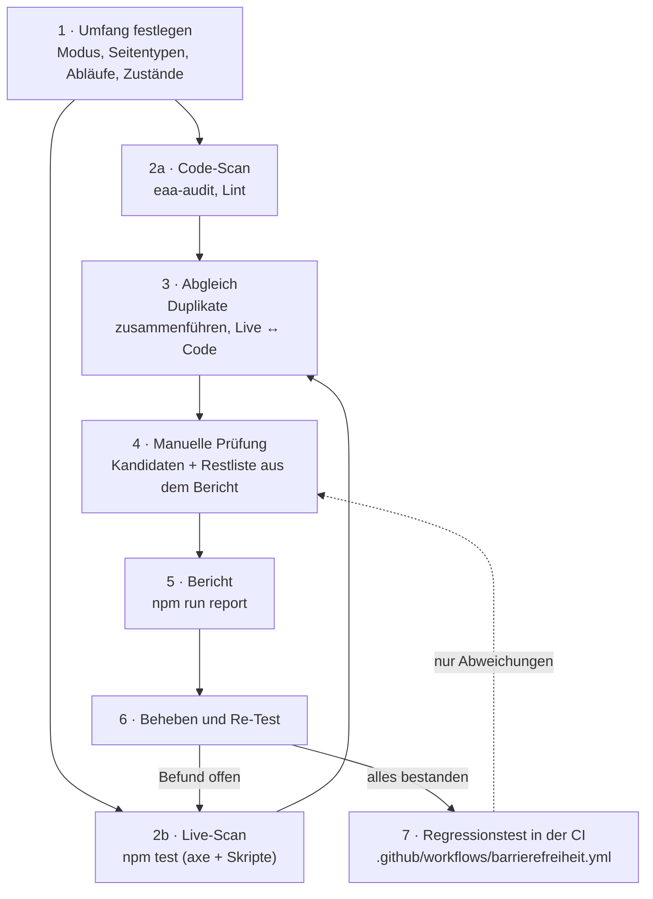

# Barrierefreiheits-Supertest – Konzept

Der Supertest prüft Websites gegen **WCAG 2.2 Stufe AA**. Damit sind WCAG 2.1 AA und die Web-Anforderungen der EN 301 549 (Kapitel 9) abgedeckt, auf die das Barrierefreiheitsstärkungsgesetz (BFSG) verweist.

Diese Datei ist die Kurzfassung für die Arbeit im Repository. Die vollständige Fassung steht in [konzept-vollstaendig.md](konzept-vollstaendig.md), die Werkzeug-Recherche in [skills-und-plugins.md](skills-und-plugins.md).

## Modi

| Modus | Eingabe | Stärke | Blinder Fleck |
| --- | --- | --- | --- |
| **Code** | Repository, Komponenten, Templates | Findet Ursachen mit Datei und Zeile | Sieht kein gerendertes Ergebnis |
| **Live** | URL (öffentlich oder Staging) | Prüft, was Nutzer:innen bekommen, inkl. Tastatur und Fokus | Kennt die Ursache im Code nicht |
| **Kombiniert** | beides | Live-Befund wird mit der Code-Stelle verknüpft | höherer Aufwand |

Empfehlung: **Kombiniert**, wann immer Code verfügbar ist.

## Werkzeuge

| Baustein | Einsatz | Modus |
| --- | --- | --- |
| Axe Accessibility (Deque, Claude-Plugin) / `@axe-core/playwright` | Regel-Scan mit axe-core | Live + Code |
| WebAbility Accessibility (Claude-Plugin) | Zweiter Scanner zum Gegenprüfen | Live |
| eaa-audit (Claude-Plugin) | Befund → WCAG-Kriterium + EN-301-549-Klausel, mit Datei und Zeile | Code |
| [wcag22-a11y-audit](https://openskillindex.com/skills/aipexstudio-aipex-wcag22-a11y-audit) | Vorlage Live-Prüfung über Accessibility-Tree, 8 Kernkriterien | Live |
| [a11y-audit](https://tessl.io/registry/skills/github/alirezarezvani/claude-skills/a11y-audit) | Vollständiger A/AA-Katalog, CI-Einbindung | Code |
| [wcag-audit-patterns](https://tessl.io/registry/skills/github/wshobson/agents/wcag-audit-patterns/review) | Checklisten, Behebungsmuster | beide |
| **Dieses Repo** | Playwright-Skripte für Tastatur, Layout, Formulare, Snapshots + Bericht | Live |
| Claude in Chrome | Manuelle Prüfung auf der echten Seite | Live |

Community-Skills vor der Installation lesen (SKILL.md) – sie sind nicht von Anthropic geprüft.

## Ablauf

**Seitenauswahl:** Startseite, je eine Seite pro Vorlage (Artikel, Liste, Formular), kritische Abläufe (Login, Suche, Kontakt, Checkout). Zustände mitprüfen: geöffnetes Menü, Modal, Fehlermeldung, Cookie-Banner – in `a11y.config.ts` über `setup`.

**Zwei Tiefen:** Der *Schnelltest* prüft die Kernkriterien (★ im [Prüfkatalog](pruefkatalog.md)) und läuft bei jedem Release. Der *Volltest* prüft den ganzen Katalog inkl. manueller Restliste, z. B. vor einem Relaunch oder jährlich.

## Automatisierung: vier Hebel

| Hebel | Was er leistet | Umsetzung |
| --- | --- | --- |
| Fehler verhindern | Regeln greifen beim Schreiben | [Lint-Vorlagen](../templates/lint/), geprüfte Farb-Tokens |
| Barrierefreie Komponenten | Einmal gründlich prüfen, danach nur korrekte Verwendung | Komponentenbibliothek + Komponententests mit axe |
| Manuelles als Skript | Tastatur, Fokus, Reflow, Textabstand, Einfügen werden gemessen | `tests/02-…04-*.spec.ts` |
| Nur Änderungen prüfen | Tree-Snapshot je Seite/Zustand; Abweichung → Review | `tests/05-aria-snapshot.spec.ts` |

### Phase 7: Regressionstest in der CI

1. **Beim Schreiben:** Lint-Regeln im Editor und als Pre-Commit-Hook.
2. **Bei jedem Pull Request:** `npm test` – axe-Scan, Tastatur-, Layout-, Formular-Skripte, Tree-Snapshot.
3. **Auswertung:** Neuer sicherer Befund *Kritisch* oder *Hoch* lässt den Build fehlschlagen. Snapshot-Abweichung → nur diese Stelle manuell prüfen.
4. **Nächtlich:** Volltest-Scan, Bericht als Artefakt und in der Job-Zusammenfassung.
5. **Pro Release:** KI-Vorprüfung geänderter Inhalte (Alt-Texte, Linktexte, Fehlermeldungen) mit dem Skill `a11y-supertest`; ein Mensch bestätigt.

### Was manuell bleibt

Echte Screenreader-Nutzung kritischer Abläufe, das abschließende Urteil über Alt-Texte und Verständlichkeit, Untertitel-Qualität, Ziehbewegungen (2.5.7), redundante Eingaben (3.3.7), Blitzen (2.3.1) und komplexe eigene Widgets. Diese Prüfungen laufen im Volltest und für neue oder geänderte Komponenten.

## Grenzen

Der Supertest ersetzt keinen Test mit Menschen mit Behinderung und kein zertifiziertes Audit. Automatische Scanner finden nach gängiger Einschätzung nur etwa 30–50 % der Probleme; die Skripte in diesem Repo verschieben weitere Kriterien von „manuell“ zu „hybrid“, aber das Urteil bei Kandidaten bleibt beim Menschen.
